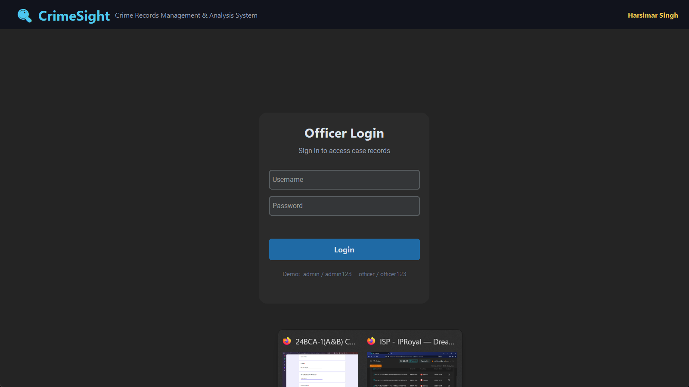
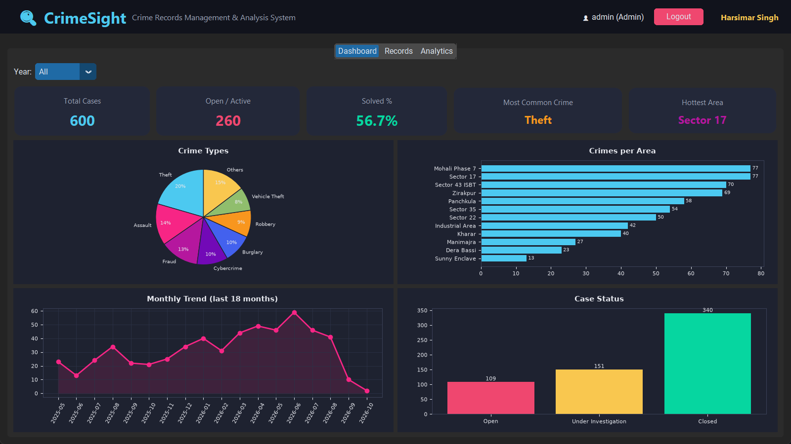
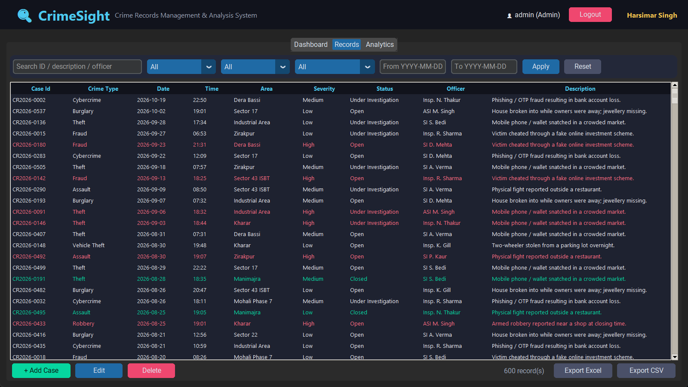
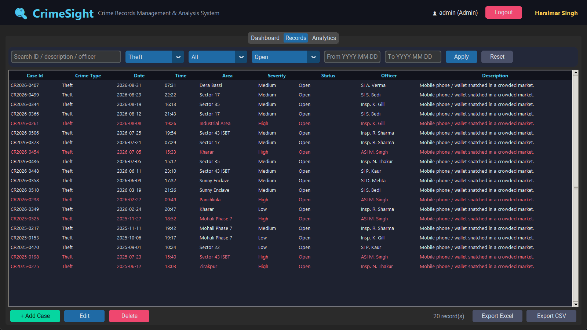
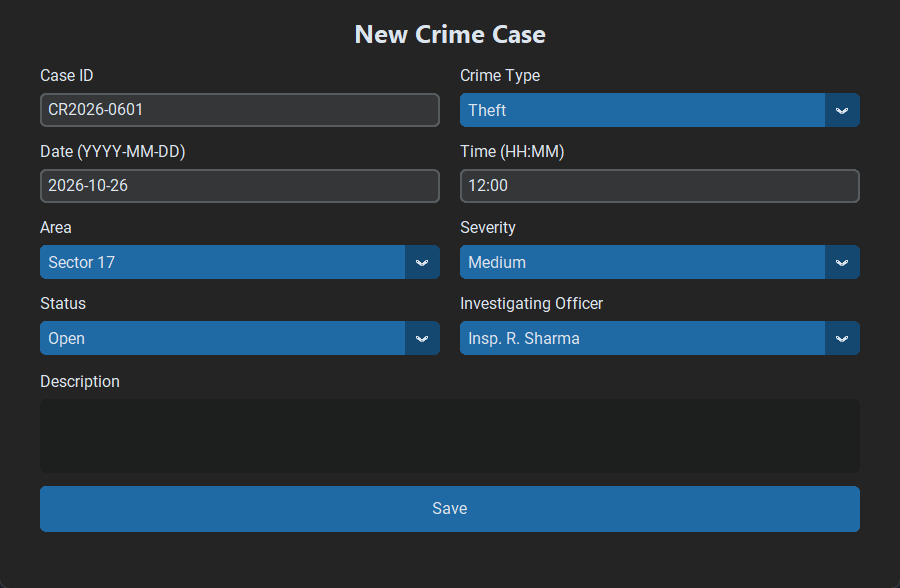
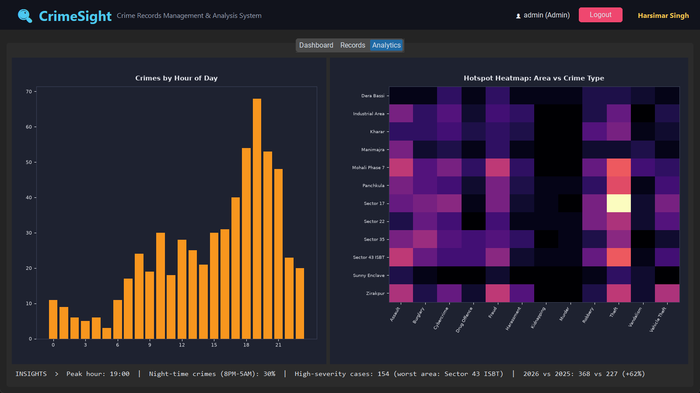

# CrimeSight - Crime Records Management & Analysis System

**Author:** Harsimar Singh

CrimeSight is a desktop application built with **Python, CustomTkinter, SQLite and Matplotlib**. It lets an officer record, search and analyse crime cases, and turns the records into charts, hotspots and insights.

## Features
- **Login** with Admin / Officer roles (passwords stored as SHA-256 hashes; only Admin can delete)
- **Case management:** add, edit, delete with input validation
- **Search and filter** by text, crime type, area, status and date range
- **Dashboard:** KPI cards (total, open, solved %, most common crime, hottest area), year filter, crime-type pie, area bar, monthly trend, case status
- **Analytics:** crimes-by-hour chart, area vs crime-type hotspot heatmap, auto-generated insights
- **Export** filtered records to CSV or Excel
- **600 sample cases** are created automatically on first run

## Screenshots

### Login


### Dashboard


### Records


### Search and filter (Theft + Open)


### Add new case


### Analytics and hotspots


## Run it
```bash
pip install -r requirements.txt
python main.py
```
Demo logins: `admin / admin123` and `officer / officer123`

## Project structure
| File | Purpose |
|---|---|
| `main.py` | GUI: login, dashboard, records table, analytics, add/edit form |
| `database.py` | SQLite tables, sample data, login and CRUD queries |
| `charts.py` | Statistics and Matplotlib charts |
| `screenshots/` | Output screenshots |
